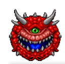

# dsh-desktop-pet · Whale Girl Desktop Pet


A **DSH-linked desktop pet** that lives on your desktop: a transparent, always-on-top,
frameless Electron window where Whale Girl lives and keeps you company while you work.
It is both a **DSH (DeepSeek Harness) bundle plugin** (one-command install with `dsh plugin`,
agent state drives the pet in real time), and can also be **packaged standalone as an exe**
to use as a regular desktop pet.

Based on [vlln/whale-girl](https://github.com/vlln/whale-girl) (the web-based Whale Girl pet plugin);
the character art and animation sheets come from that MIT project (see [NOTICE.md](NOTICE.md)).



## ✨ Features

- 🐋 **Transparent always-on-top pet**: not on the taskbar, draggable, remembers its position — sits with you, leaves with you
- 🔗 **DSH state sync**: task complete 🎉 celebrate → 💤 nap a little → wake up automatically; a new task wakes it up immediately;
  thinking / waiting / errors each have their own animation (see the sync table below)
- 🎨 **Multi-character / multi-format support**: Whale Girl built in, plus the Codex/petdex ecosystem (boba, aemeath, etc.),
  character folders are plug-and-play, all wired into the same state machine
- ⚙️ **Hot config**: size / opacity / character / wandering / sleep interval take effect instantly (DSH settings UI or config.json)
- 🖱️ **Native interaction**: left-drag to move, right-click action menu (feed / play / celebrate / settings / click-through / quit), click for a reaction
- 🧊 **Click-through / 📌 desktop bottom**: when you want to "close" the pet for a while, it stays out of the way
- 🎮 **Growth ledger**: feeding / playing / companionship time → XP → level → titles (no negative feedback)
- 🚀 **Two distribution forms**: npm plugin (DSH sync) / single-file exe (standalone pet)

## 📦 Install

### Form 1: DSH plugin (with Agent state sync)

```sh
# Install from npm (once published)
dsh plugin --profile web add @asahimoon/dsh-desktop-pet

# Or install from a local path (development)
dsh plugin --profile web add <path-to-this-package>
```

After installing, **restart `dsh web`**: the plugin loads with the profile, starts the pet window
on the desktop automatically and begins listening to Agent state. To uninstall:
`dsh plugin --profile web remove @asahimoon/dsh-desktop-pet`.

> **How the pet window starts**: the plugin tries, in order, the electron from the package's
> `node_modules`, the DSH Desktop app's own managed Electron runtime
> (`%USERPROFILE%\.dsh\electron\electron.exe`), an override via the
> `DSH_DESKTOP_PET_ELECTRON` environment variable (absolute path to any Electron binary), and
> finally an installed standalone exe (Form 2). If none is available, the plugin only sends
> signals without starting a window. If the pet crashes unexpectedly (not a deliberate quit),
> it restarts automatically, retrying up to 5 times.

### Form 1b: DSH Desktop (desktop profile)

The DSH Desktop app (the Electron shell) uses its **own plugin profile**
(`~/.dsh/profiles/desktop/`), separate from the `web` profile — installing into `web` has no
effect on the desktop app. Install into the `desktop` profile instead:

```sh
# From a local checkout (link install)
dsh plugin --profile desktop add <path-to-this-package>

# Or from npm (once published)
dsh plugin --profile desktop add @asahimoon/dsh-desktop-pet
```

Then **fully quit and restart the DSH Desktop app** (not just a page reload). The plugin loads
with the app's profile on startup, spawns the pet window automatically and starts syncing
Agent state.

**Check it worked**: the pet appears on the desktop a second or two after the app starts and
reacts to Agent activity (see the sync table below). The pet window holds the single local
port `127.0.0.1:43991`; the plugin itself opens no port.

**Updates / code changes**: with a link install the plugin code is read from your checkout on
every app start. A pet window that is already alive gets **reused**, so after changing code
**quit the old pet first** (tray icon → Quit) and then restart the DSH Desktop app — otherwise
the old window (and old code) keeps running.

**Uninstall**: `dsh plugin --profile desktop remove @asahimoon/dsh-desktop-pet`, then restart
the app. The pet's own files stay under `%APPDATA%\dsh-desktop-pet\` (config + characters) —
see the Configuration section below.

### Form 2: Standalone exe

```sh
npm run dist            # Windows: installer (nsis) + portable under dist/
npm run dist:portable   # portable single-file exe only
npm run dist:mac        # macOS: dmg + zip
npm run dist:linux      # Linux: AppImage
```

Double-click to run. Agent sync in the exe form needs the plugin form (the Node half runs inside
the DSH process); all other local behavior (napping / wandering / feeding / playing / growth) works in full.

> You can also download the installer directly from GitHub Releases (CI builds artifacts for all three platforms).

### Cross-platform

- **Windows**: native optimizations — taskbar hiding (WS_EX_TOOLWINDOW), desktop bottom (SetWindowPos)
  via Win32; special handling for DPI drift with transparent windows
- **macOS / Linux**: gracefully degrades to Electron-native features (`skipTaskbar` /
  `setAlwaysOnTop(false)`), no extra configuration needed
- Right-click menu coordinate semantics were verified against the Electron v33 source for all three
  platforms (Windows/Linux `MenuViews::PopupAt`, macOS `MenuMac::PopupAt`), always passed as
  window-relative coordinates, so positions stay consistent across multiple screens / DPIs
- Icons are complete for all three platforms (ico / icns / png sets), generated from the Whale Girl
  art by `scripts/make-icon.cjs`

## 🔗 DSH State Sync

| DSH event | Pet behavior |
|---|---|
| Tool call in progress | 🛠️ `working` animation + bubble shows the tool name |
| Turn complete (`session/event` turn/end) | 🎉 `celebrate` cheer → 💤 sleeps 25 s → back to idle automatically |
| New task arrives (exec heartbeat) | Wakes up immediately and goes to work |
| Task failed / LLM request error | 😱 `error` startle → `disappointed` slump |
| Thinking (turn/start) | 💭 `think` floating pensively |
| Waiting for approval / blocked | 🕐 `wait` wiggle of anticipation |
| New session (`agent/session-start`) | 👋 `welcome` wave |
| Heartbeat sync (5 s) | State aligned; survives a restart and catches up |

**📋 Task-progress black box**: a wide, flat black info box below the pet (like the original
whale-girl message box, with a transparent wider zone on the right of the window for text).
Two forms:

- **Hover**: a brief glance — `[23:30] 🛠️ Executing pwsh` + `📋 2/3 · Verify`
- **Persistent** (right-click menu "📋 Always show task progress" or the settings checkbox):
  - Brief: same as hover
  - Detailed (right-click "📋 Detailed progress" or the settings checkbox): current tool + **what it is
    actually doing** (`📎 F:\AI_workspace\src\main.js` — the file path being read/written, the grep
    directory, the pwsh command etc., taken from the tool-call arguments) + completed steps
    (`📋 2/3 Verify ✅Research ✅Coding`); when idle, shows the tools actually executed
    (`🛠️ Executed: pwsh · read_file`)

The `[HH:MM]` timestamp matches the original whale-girl memory-note format, refreshed every 5 seconds;
while the agent works, the black box takes precedence over the bubble.

Signals are pushed as local HTTP POST to `127.0.0.1:43991` (loopback only, no network exposure).

## 💬 Pet Chat (no need to open the web UI)

Click "💬 Chat" in the pet-window right-click menu or the tray menu, and the dialog **opens directly
in the pet window, beside the pet model** (the window temporarily grows, the pet keeps its spot):
type in the input, press Enter to send, and the agent's reply **streams live** — everyday
questions and simple tasks no longer need the browser.

- **Chat history**: the 🗂️ button at the top of the panel expands the **chat history list** (each
  conversation shows a title + last-message preview); clicking any conversation loads its full
  history so you can continue chatting in **that conversation**
- **Single port**: the whole plugin only uses **`127.0.0.1:43991`** (held by the pet window). The
  plugin's Node half listens on no port — it pushes state and chat signals to `/signal` and
  **long-polls `/poll`** to collect commands queued by the chat window (prompt / list-sessions /
  select-session); both directions use this one port
- **Target session**: when no history session is selected, chat with the **most recently active**
  Agent first; when no Agent is active, automatically resume the **most recently persisted session**
- **Parallel**: chatting wakes that session's agent to drive the turn; it is the same session as the
  web GUI, so progress is visible on both sides

## ⚙️ Configuration

Plugin form: configuration is registered into the DSH settings (`dsh-desktop-pet:` section) and
takes effect live while the pet window is running. The pet's own `%APPDATA%/dsh-desktop-pet/config.json`
(settings panel or manual edit) is the persistent source of truth — DSH settings edits are applied as a
field-wise patch, so they never overwrite a character (or any other field) chosen in the pet itself.

```yaml
dsh-desktop-pet:
  size: 110              # window size px (64–256)
  opacity: 1             # opacity (0.2–1)
  character: whale-girl  # character id
  walk:
    enabled: true        # wander toggle
    intervalMs: 300000   # wander interval (ms)
    durationMs: 26000    # one wander length (ms)
  sleepAfterMs: 60000    # how soon idle turns into a nap (ms)
  taskBarPersistent: false  # keep the task-progress black box always visible
  taskBarDetailed: false    # when persistent, show detailed progress (completed steps / executed tools)
  hideWhenIdle: false       # hide the pet window entirely during its long-quiet sleep (reappears on activity)
```

The standalone exe form edits `%APPDATA%/dsh-desktop-pet/config.json` directly; saving takes
effect live. The plugin form uses the same `config.json` — the DSH settings registration is only an
extra live-edit path, not a second store.

## 🎭 Multi-Character / Multi-Format Support

The pet discovers characters in **two character directories**:

1. `%APPDATA%/dsh-desktop-pet/characters/<id>/` — **single managed directory** (written at runtime):
   the built-in character (Whale Girl) is automatically copied in on **first launch**, living with
   petdex imports and manually placed characters; open the folder to view, edit and delete them
2. `assets/characters/<id>/` — bundled with the package (read-only, used as fallback when the
   user directory does not have them)

> The built-in character is **copy-to-manage**: to change Whale Girl's art, just edit the files in
> `characters/whale-girl/` (user directory wins). Deleting the folder restores it on the next
> launch (effectively "restore defaults"); to remove it for good, write one `whale-girl` line in
> `.ignore`.

How to add a character:

```sh
npx petdex install <pet-name>        # 1) petdex ecosystem: auto-imported at startup
# or 2) put any codex/native character folder into %APPDATA%/dsh-desktop-pet/characters/
```

Supported formats (all wire into the same state machine + DSH sync; missing states fall back to
idle, never a blank screen):

| Format | Marker files | Description |
|---|---|---|
| native | `manifest.json` + per-state PNG strips | This project's native format (Whale Girl) |
| codex | `pet.json` + spritesheet | Codex / petdex ecosystem; supports custom `animations` and the official default table, states auto-map |

Other notes:

- The character name comes from manifest / pet.json; the settings-panel character dropdown marks
  the source (`· Codex`)
- To stop auto-import/restore for a character: write one id per line in `characters/.ignore`
- To delete a character: delete the `characters/<id>/` folder (the built-in character restores on
  next launch unless listed in `.ignore`)
- Character art copyright belongs to the original authors; confirm the license before redistributing
  (the built-in whale-girl in this project is MIT)

## 🖱️ Interaction

| Action | Behavior |
|---|---|
| Left-drag hold | Move the pet |
| Left-click | Happy reaction (hop + random line; clicking a sleeping pet wakes it) |
| Right-click | Action menu: feed / play / celebrate / always-show-task-progress toggle / settings / desktop bottom / click-through / quit |
| Tray | Show/hide, move to bottom-right, bottom mode, click-through (checkbox state stays in sync), quit |

## 🛠️ Development

```sh
npm install        # install dependencies (electron + electron-builder + koffi + schemastery + vitest)
npm start          # run the pet window (standalone mode)
npm run dev        # dev mode (with DevTools)
npm run check      # syntax check
npm test           # unit tests (vitest: task-signal tracking / state machine / black-box text)
npm run dist       # package the Windows exe (nsis + portable); dist:mac / dist:linux for other platforms
```

### Smoke tests (scripts/smoke/)

Smoke tests drive the packaged exe with real Win32 input + CDP, verifying menu placement /
click-through / dragging / idle animations / DSH nap sync. First launch the packaged build with
`--remote-debugging-port=9222`:

```sh
npm run dist
"dist/DSH Desktop Pet 0.2.0.exe" --remote-debugging-port=9222
npm run smoke:menu     # right-click menu position
npm run smoke:pierce   # click-through toggle + dragging
npm run smoke:idle     # idle animation + click reaction
npm run smoke:drag     # drag displacement
npm run smoke:nap      # task complete → nap → wake (run in background; avoids exec heartbeat interference)
```

## 🚀 Publishing to GitHub and npm

### GitHub

```sh
git init
git add .
git commit -m "feat: dsh desktop pet"
git branch -M main
git remote add origin https://github.com/<your-username>/dsh-desktop-pet.git
git push -u origin main
git tag v0.2.0 && git push origin v0.2.0   # trigger the CI exe build (Actions → Artifacts)
```

CI (`.github/workflows/build.yml`) automatically runs unit tests + syntax checks on the main
branch and `v*` tags, then packages and uploads each platform's artifacts on
**Windows / macOS / Linux**.

### npm

```sh
npm login
npm publish          # before publishing, edit the author / repository fields in package.json
```

After publishing:

```sh
dsh plugin --profile web add @asahimoon/dsh-desktop-pet
```

> Before publishing: `npm pack --dry-run` previews what will be published (the `files`
> allowlist is configured; node_modules / dist / smoke scripts are excluded).

## 📁 Project Structure

```
index.mjs          # DSH bundle Node half: Agent events → HTTP signals → launch pet window
config.mjs         # config schema (schemastery) + defaults (single source of truth)
main.js            # Electron main process: window/tray/click-through/persistence/signal service/character scan/hot config
preload.js         # secure bridge (contextIsolation)
renderer/          # frame player + state machine + interaction + DSH signal handling + character adapters
assets/characters/ # built-in character (whale-girl, MIT)
scripts/smoke/     # smoke tests (real input + CDP, see "Development")
cordis.patch.yml   # bundle patch: mount the Node half
docs/              # documentation screenshots
```

## 📄 License and Acknowledgements

- This project is MIT ([LICENSE](LICENSE))
- The Whale Girl character sprites and animation sheets come from [vlln/whale-girl](https://github.com/vlln/whale-girl)
  (MIT; character art by ZipZipPipe), see [NOTICE.md](NOTICE.md)
- Runtime uses Electron (MIT)
- Other character art copyright belongs to their authors; please confirm the license
